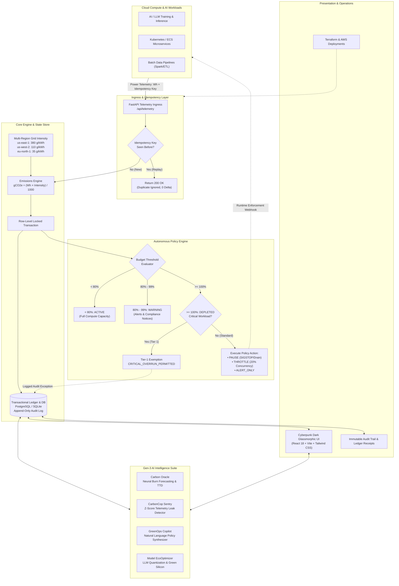
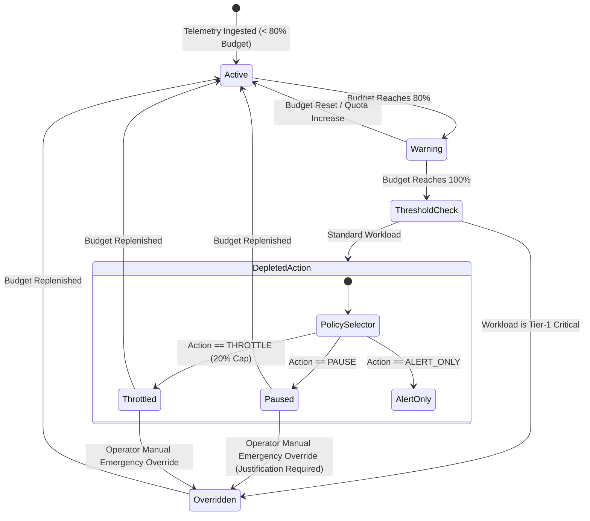
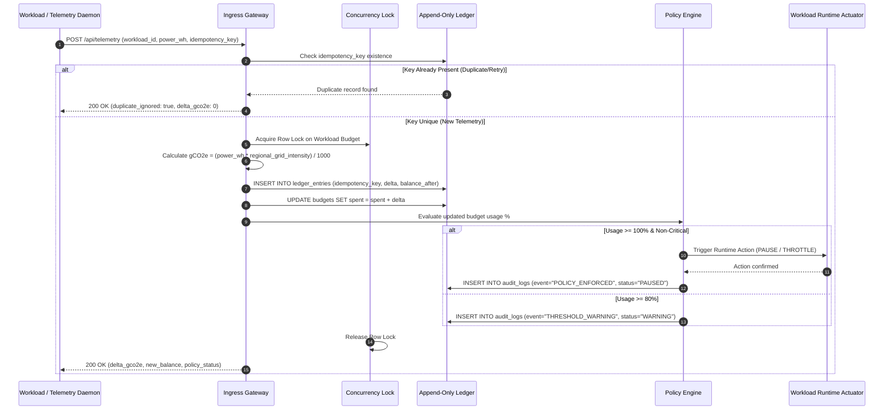
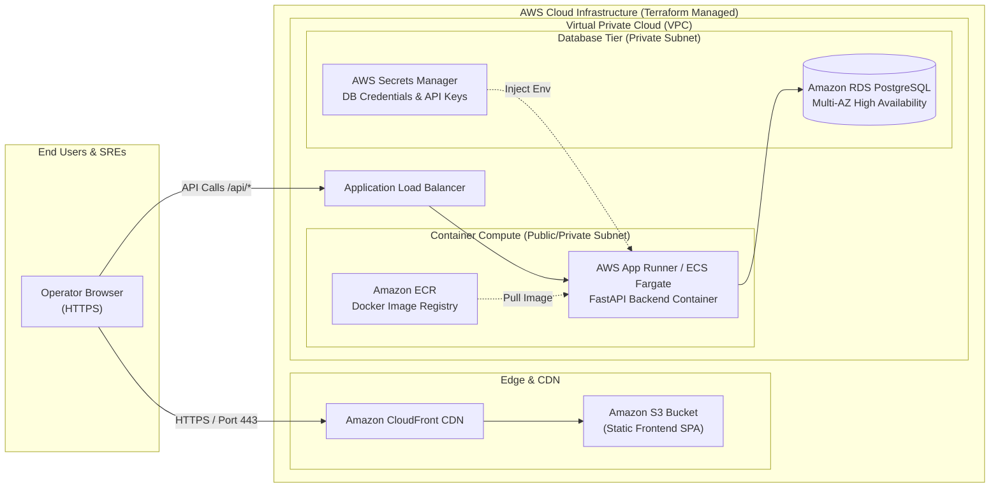

# CarbonGuard: Autonomous Carbon Budget Governance for Cloud Computing

> **Challenge 3: Carbon Budget for Computing**  
> An autonomous policy engine and transactional ledger that meters cloud workload power, calculates grid-aware $gCO_2e$ emissions, enforces runtime quotas (Pause, Throttle, Alert), and provides an immutable audit dashboard.

---

## 🏗️ System Architecture & Data Flow



---

## ⚡ Policy Lifecycle & Enforcement State Machine



---

## 🔄 Transactional Ledger Double-Entry Sequence



---

## ☁️ AWS Cloud Infrastructure Architecture



---

## 🌟 Key Highlights & Engineering Features

1. **Transactional, Append-Only Ledger**:
   - Double-entry emissions accounting with unique **idempotency keys** (`idempotency_key`) to mathematically prevent duplicate telemetry counting during network retries.
   - Database row-level locking ensures thread-safe, concurrent budget deductions without race conditions.

2. **Policy Enforcement Engine**:
   - **< 80%**: Status `ACTIVE` (Full compute capacity).
   - **80% - 99%**: Status `WARNING` (Visual alerts & compliance notifications).
   - **>= 100%**: Status `DEPLETED` (Triggers configured action: `PAUSE`, `THROTTLE` to 20% concurrency, or `ALERT_ONLY`).
   - **Critical Workload Exemption**: Tier-1 mission-critical workloads are never hard-paused; they enter `OVERRIDDEN` mode with logged audit justifications.

3. **Multi-Region Grid Carbon Intensity Model**:
   - Regional grid factors: `us-east-1` (380 g/kWh), `us-west-2` (110 g/kWh), `eu-north-1` (35 g/kWh).
   - Live switching demonstrates how shifting cloud regions reduces emissions by up to **90%** for the exact same compute workload!

4. **Audit & Compliance Dashboard**:
   - Cyberpunk dark glassmorphism interface (React 18 + Vite + Tailwind CSS + Lucide Icons + Recharts).
   - Live burn-down chart, interactive simulation control deck, chaos testing (power spikes & duplicate replay), and expandable audit logs.

5. **Gen-3 AI Carbon Intelligence Suite**:
   - **Carbon Oracle (Predictive Forecasting)**: Neural burn-rate extrapolation with 95% confidence cones, estimated Time-To-Depletion (TTD), and interactive What-If scenario modeling (baseline, hydro shift, concurrency throttling, and surge stress).
   - **CarbonCop Sentry (Leak & Anomaly Detection)**: Continuous statistical Z-score telemetry scanner detecting runaway inference loops, phantom idle leaks, and dirty grid spikes with 1-click autonomous remediation.
   - **GreenOps Copilot & Natural Language Policy Synthesizer**: Interactive conversational AI assistant contextualized on live ledger state; compiles human English constraints into structured, executable policy rules with 1-click deployment.
   - **Model EcoOptimizer**: AI/LLM model quantization calculator (FP32 vs FP16 vs INT8 vs INT4 AWQ), computing real-time energy savings, carbon averted, memory reduction, and AWS green silicon recommendations (Inferentia2, Trainium, Graviton).
   - **Green Cloud Efficiency Scorecard**: Algorithmic letter rating (A+ to F) evaluating Grid Cleanliness, Budget Health, Compute Efficiency, and Ledger Governance.

---

## 📂 Repository Architecture

```text
.
├── backend/                  # FastAPI Core & Policy Engine
│   ├── app/
│   │   ├── api/              # Endpoints (apps, budgets, telemetry, workloads, audit, simulation, ai)
│   │   ├── core/             # Config, async database engine (aiosqlite / postgresql)
│   │   ├── models/           # SQLAlchemy models (App, Budget, Usage, LedgerEntry, AuditLog)
│   │   ├── schemas/          # Pydantic validation schemas
│   │   ├── services/         # LedgerService, PolicyEngine, WorkloadSimulator, AIEngine
│   │   └── main.py           # Application entrypoint
│   ├── tests/                # Automated pytest suite (idempotency, concurrency, policy thresholds)
│   ├── Dockerfile            # Multi-stage production container
│   └── requirements.txt
├── frontend/                 # React 18 + Vite Audit Dashboard
│   ├── src/
│   │   ├── components/       # MetricCards, BurnRateChart, SimulationControlDeck, AuditTable, AISuitePanel
│   │   ├── pages/            # Unified DashboardPage
│   │   ├── services/         # Typed API client
│   │   └── styles/           # Tailwind glassmorphism & cyberpunk glow themes
│   ├── Dockerfile            # NGINX alpine container
│   ├── nginx.conf
│   └── package.json
├── deploy/aws/               # AWS Cloud Deployment Assets
│   ├── main.tf               # Terraform: ECR, RDS PostgreSQL, S3, CloudFront
│   ├── variables.tf
│   ├── outputs.tf
│   └── deploy-aws.ps1        # One-click AWS CLI deployment script
├── docker-compose.yml        # Instant local full-stack execution
├── LICENSE                   # MIT License
└── README.md
```

---

## 🚀 Quickstart: Running Locally

### Option 1: Direct Run (Fastest)

#### 1. Start the Backend
```bash
cd backend

# Create & activate virtual environment
python -m venv .venv
.venv\Scripts\activate          # Windows PowerShell / CMD
# or: source .venv/bin/activate  # Linux / macOS

# Install dependencies
pip install -r requirements.txt

# Run FastAPI dev server
uvicorn app.main:app --reload --port 8000
```
*API will be available at `http://localhost:8000` (Interactive Swagger docs at `http://localhost:8000/docs`).*

#### 2. Start the Frontend Dashboard
```bash
cd frontend

# Install node dependencies
npm install

# Start Vite dev server
npm run dev
```
*Open `http://localhost:5173` in your browser.*

---

### Option 2: Docker Compose (Full Stack)
```bash
docker compose up --build
```
- Dashboard: `http://localhost:3000`
- API & Docs: `http://localhost:8000/docs`

---

## 🧪 Running Automated Tests
```bash
cd backend
.venv\Scripts\python -m pytest tests/test_policy.py tests/test_all_endpoints.py tests/test_ai.py -v
```
**Tests Covered**:
- ✅ Deterministic budget burn calculation: $E(Wh) \times I(g/kWh) / 1000 = C(gCO_2e)$.
- ✅ Replay prevention: sending identical idempotency key returns `duplicate_ignored` with $0\,gCO_2e$ delta.
- ✅ Threshold crossing to `WARNING` at $\ge 80\%$.
- ✅ Threshold crossing to `DEPLETED` and automatic transition to `PAUSED` at $\ge 100\%$.
- ✅ Criticality exception: Critical apps stay online with `CRITICAL_OVERRUN_PERMITTED` logged.
- ✅ End-to-end audit trail verification.
- ✅ AI forecasting, anomaly detection, and NLP policy synthesis validation.

---

## ☁️ Deploying to AWS Cloud

### Architecture Overview
- **Compute (Backend API)**: AWS App Runner or Amazon ECS Fargate.
- **Database (Ledger & State)**: Amazon RDS PostgreSQL (`db.t4g.micro`).
- **Frontend**: Amazon S3 + CloudFront CDN (Global HTTPS delivery).
- **Security & IAM**: VPC isolation, Private Subnets, AWS Secrets Manager for DB credentials.

### Deploying via Terraform & AWS CLI:
```bash
# 1. Configure AWS credentials
aws configure

# 2. Build and push backend image to Amazon ECR
ACCOUNT_ID=$(aws sts get-caller-identity --query Account --output text)
aws ecr create-repository --repository-name carbonguard-backend --region us-east-1
aws ecr get-login-password --region us-east-1 | docker login --username AWS --password-stdin $ACCOUNT_ID.dkr.ecr.us-east-1.amazonaws.com

cd backend
docker build -t carbonguard-backend .
docker tag carbonguard-backend:latest $ACCOUNT_ID.dkr.ecr.us-east-1.amazonaws.com/carbonguard-backend:latest
docker push $ACCOUNT_ID.dkr.ecr.us-east-1.amazonaws.com/carbonguard-backend:latest

# 3. Provision Infrastructure with Terraform
cd ../deploy/aws
terraform init
terraform apply -auto-approve

# 4. Upload Frontend to S3
cd ../../frontend
npm run build
aws s3 sync dist/ s3://$(terraform -chdir=../deploy/aws output -raw frontend_s3_bucket) --delete
```

---

## 🎬 Live Demonstration Script for Evaluators

1. **Baseline**: Open Dashboard. Observe `ML-Recommender-Engine` running safely at `0%` burn.
2. **Start Telemetry Stream**: Click **"Start Telemetry Stream"** on the Control Deck. Watch the real-time Recharts burn curve start climbing.
3. **Region Comparison**: Switch region from `us-east-1` (380 g/kWh) to `eu-north-1` (35 g/kWh). Point out how the rate of carbon accumulation immediately drops by **90%** due to clean Nordic grid energy.
4. **Chaos Testing (Power Spike)**: Click **"Inject Instant 80Wh Power Spike"**. The budget rapidly passes 80% (badge turns **Amber - WARNING**) and hits 100% (badge turns **Red - PAUSED**).
5. **Enforcement**: Verify that the Workload Status immediately displays **POLICY ENFORCED: PAUSED**.
6. **Idempotency Replay**: Click **"Replay Duplicate Telemetry"**. Show the green confirmation badge indicating the duplicate event was detected and ignored without double counting.
7. **Operator Override**: Open the **"Grant Emergency Override"** dialog. Enter a justification (e.g., *"Customer critical pipeline recovery"*), apply it, and show how the worker resumes running with an immutable audit entry recorded.
8. **AI Carbon Suite**: 
   - Open **Carbon Oracle** to view 95% confidence intervals and What-If scenario simulations.
   - Run **CarbonCop Sentry** to detect statistical telemetry anomalies and trigger 1-click remediation.
   - Use **GreenOps Copilot** to synthesize human policies into executable enforcement rules.
   - Calculate savings with **Model EcoOptimizer** when switching models to INT8 / INT4 on AWS Inferentia2.
